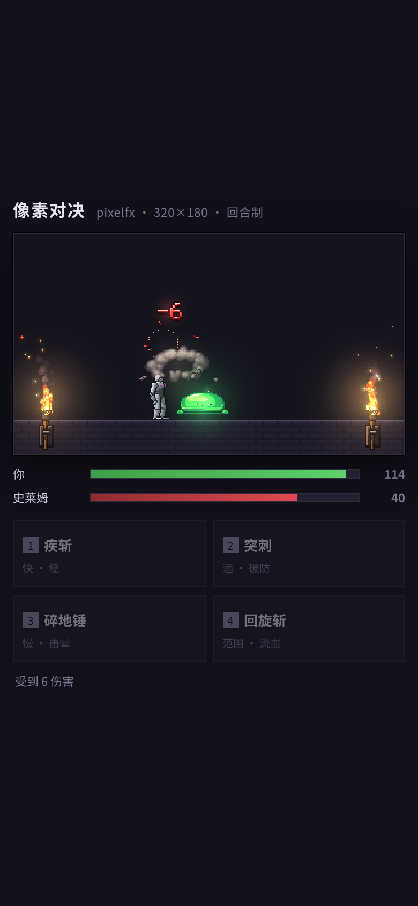

# 像素对决 · pixelfx duel

用 [**pixelfx**](https://github.com/patch-gg/pixelfx)（244 个代码驱动的像素特效）做的一个**回合制像素对战 DEMO**。
没有美术资源、没有游戏引擎，整个游戏只有一个 320×180 的像素缓冲 + 18 个特效模块。

**▶ 在线试玩：** https://chen7622132.github.io/pixelfx-duel/



---

## 怎么玩

| 键 | 招式 | 伤害 | 特性 |
|---|---|---|---|
| `1` | 疾斩 | 11–15 | 快、无冷却，稳的 |
| `2` | 突刺 | 14–18 | 冷却 1 回合，**识破蓄力可打断**（×1.5 伤害） |
| `3` | 碎地锤 | 28–34 | 冷却 2 回合，命中 30% 击晕（对手跳过一回合） |
| `4` | 回旋斩 | 13–17 | 冷却 1 回合，附加流血（每回合 −3） |

- 敌人每回合有 **30% 概率蓄力**（头顶弹出 `!`），蓄力那一下伤害 ×1.8；**看到感叹号就用 `2` 突刺打断**——这是这套 DEMO 里唯一的"读招"决策。
- 三只怪递进：史莱姆 → 蝙蝠 → 幽魂，每击杀一只回血 14–18。
- 死了点"再来一局"。

## 技术要点

- **内部渲染 320×180，显示时整数倍放大 4 倍到 1280×720**（`image-rendering: pixelated`）。之所以定 320×180：pixelfx 的 10 个全屏转场全部是 320×180 且不支持缩放（`Painter` 只能翻转/旋转），舞台定错就有 160px 永远遮不住。
- **一块共享 frame**：所有特效、角色、火把都画进同一个 `{color, light}` 双缓冲，`composite()` 一次输出 RGBA，`putImageData` 到离屏 canvas，再 `drawImage` 放大。绝不每个特效一块 frame。
- **分层顺序**：背景 → 火把 back → 敌人 back → 招式 back → 角色 → 招式 front → 敌人 front → 状态 → 飘字 → 全屏转场。
- **打击感**：命中瞬间取招式自带的 `shake` / `amp` 值震屏，敌人抖动 0.2s，`ui/damage-number` 飘字（`options.text` 传真实伤害）、暴击换 `ui/crit-number` + `impacts/crit-hit`。
- 特效 `update(dt)` 内部固定 120Hz 步进，帧率波动不影响表现。

## 用了哪 18 个特效

| 用途 | 效果 |
|---|---|
| 招式 | `melee/sword-slash` `melee/thrust` `melee/hammer-smash` `melee/spin-slash` |
| 命中 | `impacts/blunt-hit` `impacts/crit-hit` |
| 状态 | `status/burning` `status/poisoned` `status/bleeding` `status/stunned` |
| 敌人 | `critters/slime` `critters/bat` `critters/ghost` |
| 界面 | `ui/damage-number` `ui/crit-number` `ui/exclamation` |
| 场景 | `fire/torch`（左右两支，同时当光源） |
| 转场 | `transitions/burn-away`（击杀全屏烧掉） |

## 本地跑

```bash
python3 -m http.server 8000
# 打开 http://127.0.0.1:8000/
```

无构建、无依赖：`index.html` 用原生 ESM 直接 `import` `vendor/pixelfx/` 里的模块。

## 自检

```bash
npm i playwright && npx playwright install chromium-headless-shell
node check.mjs
```

会验证：无 console 报错、canvas 尺寸、无横向溢出、出击后敌人掉血、一回合后玩家掉血、75 秒自动打完全流程不崩。

## 许可

- 本项目代码：MIT。
- `vendor/pixelfx/` 来自 [patch-gg/pixelfx](https://github.com/patch-gg/pixelfx)，**MIT**，Copyright (c) 2026 Patch / Hugo Duprez，见 `vendor/pixelfx/LICENSE` 与 `NOTICE.md`（部分效果改编自 Sprite Fusion 与 Hollow Crown，均为 MIT）。
- **Patch Pixel 字体不在 MIT 范围内**，因此本仓库不包含该字体。

## 后续

- [ ] 把 12 个 `moves/` 完整招式做成"终结技特写"（需要临时把画布扩到 480×270）
- [ ] 元素相克：火/冰/雷/奥术/圣光/暗影，靠 `palette` 换色做同招异色
- [ ] `pickups/` 加掉落，`ui/level-up` + `ui/achievement` 加成长
- [ ] 存活模式：无限怪，比回合数
